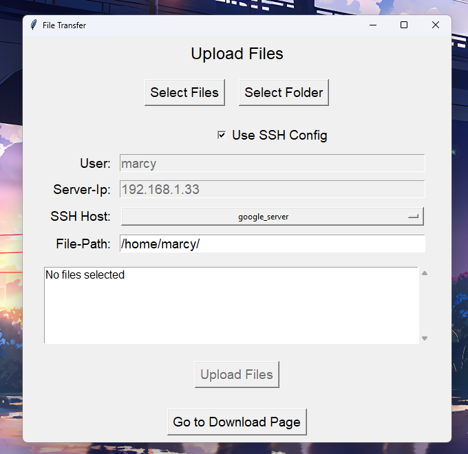
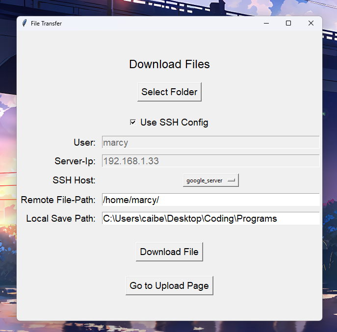

<a id="readme-top"></a>

[![Contributors][contributors-shield]][contributors-url]
[![Forks][forks-shield]][forks-url]
[![Stargazers][stars-shield]][stars-url]
[![Issues][issues-shield]][issues-url]
[![License][license-shield]][license-url]

<h3 align="center">SSH Controller</h3>

<p align="center">
    A small desktop GUI for uploading and downloading files over SSH, with hosts taken from your SSH config.
    <br />
    <br />
    <a href="https://github.com/MarcyVibin/ssh_controller/issues">Report Bug</a>
    &middot;
    <a href="https://github.com/MarcyVibin/ssh_controller/issues">Request Feature</a>
</p>

<!-- TABLE OF CONTENTS -->
<details>
  <summary>Table of Contents</summary>
  <ol>
    <li>
      <a href="#about-the-project">About The Project</a>
      <ul>
        <li><a href="#built-with">Built With</a></li>
      </ul>
    </li>
    <li>
      <a href="#getting-started">Getting Started</a>
      <ul>
        <li><a href="#requirements">Requirements</a></li>
        <li><a href="#installation">Installation</a></li>
      </ul>
    </li>
    <li><a href="#usage">Usage</a></li>
    <li><a href="#license">License</a></li>
    <li><a href="#contact">Contact</a></li>
  </ol>
</details>

---

## About The Project

**SSH Controller** makes copying files to and from a server less fiddly. Instead of typing `scp` commands, you pick files or a folder in a window, choose a host, and click **Upload Files** or **Download File**. It builds and runs the `scp` command for you and tells you whether it worked.

Key features:

- Upload page for files or whole folders, download page for remote files
- Host dropdown filled from the `Host` entries in your `~/.ssh/config`
- Alternatively, type a username and server by hand if the host is not in your config
- Success and error pop-ups, based on the exit code of `scp`
- Tested on Windows and Linux




<p align="right">(<a href="#readme-top">back to top</a>)</p>

### Built With

* [![Python][Python.org]][Python-url]
* Tkinter (built into Python)
* OpenSSH `scp` (system binary)

<p align="right">(<a href="#readme-top">back to top</a>)</p>

---

## Getting Started

### Requirements

- Python 3
- OpenSSH client with `scp` available on `PATH`
- Tkinter. On Linux it is a separate package:

```sh
sudo apt install python3-tk
```

### Installation

Clone the repository:

```sh
git clone https://github.com/MarcyVibin/ssh_controller.git
cd ssh_controller
```

---

## Usage

Start the app:

```sh
python upload_and_download.pyw
```

On Windows you can also double-click `upload_and_download.pyw`.

To use the host dropdown, add your servers to the SSH config first (`~/.ssh/config`, or `%USERPROFILE%\.ssh\config` on Windows):

```
Host myserver
  HostName 192.168.1.10
  User marc
```

Otherwise untick **Use SSH Config** and fill in **User** and **Server-Ip** by hand. Then click **Upload Files** or **Download File**.

<p align="right">(<a href="#readme-top">back to top</a>)</p>

---

## License

Distributed under the GNU General Public License v3.0 (GPL-3.0). See `LICENSE` for more information.

---

## Contact

Marc Steger - marc.steger06@gmail.com

Project Link: https://github.com/MarcyVibin/ssh_controller

<p align="right">(<a href="#readme-top">back to top</a>)</p>

<!-- Badge Links -->

[Python.org]: https://img.shields.io/badge/Python-3-3776AB?style=for-the-badge&logo=python&logoColor=white
[Python-url]: https://www.python.org/

[contributors-shield]: https://img.shields.io/github/contributors/MarcyVibin/ssh_controller.svg?style=for-the-badge
[contributors-url]: https://github.com/MarcyVibin/ssh_controller/graphs/contributors

[forks-shield]: https://img.shields.io/github/forks/MarcyVibin/ssh_controller.svg?style=for-the-badge
[forks-url]: https://github.com/MarcyVibin/ssh_controller/network/members

[stars-shield]: https://img.shields.io/github/stars/MarcyVibin/ssh_controller.svg?style=for-the-badge
[stars-url]: https://github.com/MarcyVibin/ssh_controller/stargazers

[issues-shield]: https://img.shields.io/github/issues/MarcyVibin/ssh_controller.svg?style=for-the-badge
[issues-url]: https://github.com/MarcyVibin/ssh_controller/issues

[license-shield]: https://img.shields.io/github/license/MarcyVibin/ssh_controller.svg?style=for-the-badge
[license-url]: https://github.com/MarcyVibin/ssh_controller/blob/main/LICENSE
